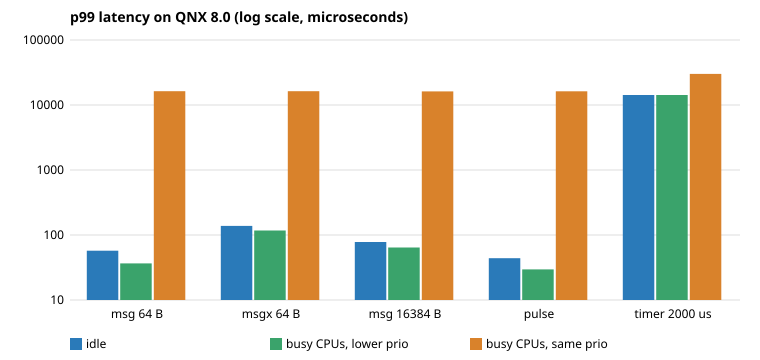

# ipcbench report

Target: cpus=2, cycles_per_sec=3691004509, samples=20000, timer_us=2000, prio=40
Phase durations: none 46.2 s, low 46.0 s, same 190.6 s

| test | idle p50 / p99 / max (us) | busy CPUs, lower prio p50 / p99 / max (us) | busy CPUs, same prio p50 / p99 / max (us) |
|---|---|---|---|
| msg 4 B | 23.1 / 58.2 / 433.1 | 19.5 / 34.2 / 290.4 | 15045.6 / 16239.5 / 16423.1 |
| msg 64 B | 24.7 / 57.3 / 484.7 | 20.1 / 36.6 / 236.9 | 15087.1 / 16276.4 / 16399.8 |
| msg 1024 B | 26.0 / 60.2 / 320.9 | 20.7 / 38.7 / 264.1 | 15051.5 / 16217.0 / 16437.9 |
| msg 16384 B | 47.2 / 78.1 / 294.6 | 37.2 / 64.2 / 255.2 | 15041.1 / 16207.7 / 16473.9 |
| msg 65536 B | 79.8 / 131.8 / 533.6 | 88.3 / 122.0 / 361.8 | 15090.3 / 16247.3 / 16587.6 |
| msgx 4 B | 78.4 / 128.4 / 363.7 | 81.6 / 113.9 / 348.2 | 15084.4 / 16313.8 / 16857.5 |
| msgx 64 B | 77.7 / 137.9 / 348.6 | 81.6 / 117.3 / 474.1 | 15079.1 / 16303.3 / 16654.0 |
| msgx 1024 B | 75.8 / 126.6 / 421.7 | 83.3 / 123.0 / 367.5 | 15083.1 / 16227.5 / 16346.1 |
| msgx 16384 B | 115.3 / 206.2 / 560.5 | 150.8 / 200.8 / 439.4 | 15077.3 / 16243.6 / 16871.5 |
| msgx 65536 B | 150.5 / 257.6 / 637.5 | 213.2 / 317.8 / 715.9 | 15115.6 / 16312.6 / 16831.0 |
| pulse | 16.5 / 44.0 / 235.9 | 12.1 / 29.5 / 241.1 | 15046.5 / 16267.3 / 16934.5 |
| timer 2000 us | 13130.5 / 14259.6 / 14755.5 | 13095.2 / 14244.8 / 14726.4 | 13072.6 / 30083.6 / 44007.2 |

