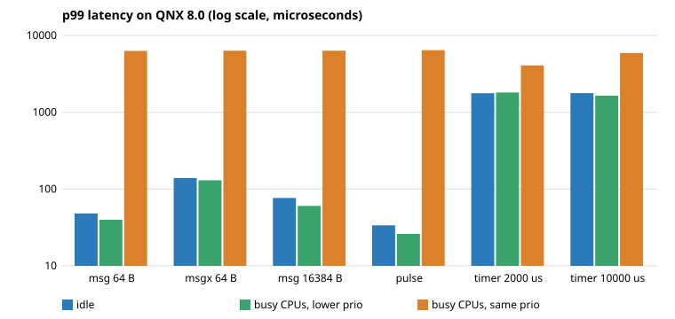

# ipcbench report

Target: cpus=2, cycles_per_sec=3690213500, clock_period_ns=1000000, samples=20000, timer_us=2000, prio=40
Phase durations: none 19.8 s, low 22.4 s, same 51.4 s

| test | idle p50 / p99 / max (us) | busy CPUs, lower prio p50 / p99 / max (us) | busy CPUs, same prio p50 / p99 / max (us) |
|---|---|---|---|
| msg 4 B | 11.7 / 51.1 / 283.1 | 19.4 / 42.0 / 286.5 | 4185.9 / 6312.0 / 7486.0 |
| msg 64 B | 12.6 / 48.1 / 355.7 | 18.7 / 39.8 / 289.2 | 4605.9 / 6304.6 / 6997.2 |
| msg 1024 B | 14.5 / 54.1 / 259.7 | 20.7 / 40.7 / 351.4 | 4548.7 / 6340.8 / 7190.3 |
| msg 16384 B | 24.5 / 76.6 / 518.6 | 32.6 / 60.2 / 309.0 | 4573.4 / 6339.5 / 6528.7 |
| msg 65536 B | 52.1 / 133.4 / 544.1 | 76.1 / 119.8 / 447.0 | 4001.8 / 6258.0 / 6573.0 |
| msgx 4 B | 48.4 / 120.2 / 409.0 | 70.5 / 141.1 / 541.1 | 4211.3 / 6289.5 / 6493.0 |
| msgx 64 B | 49.3 / 139.0 / 354.8 | 79.0 / 129.9 / 376.5 | 4498.6 / 6335.5 / 6617.3 |
| msgx 1024 B | 49.2 / 124.8 / 460.0 | 79.3 / 134.4 / 452.9 | 3117.3 / 6288.7 / 6584.4 |
| msgx 16384 B | 88.0 / 209.3 / 512.8 | 140.6 / 207.0 / 501.0 | 3151.7 / 6200.9 / 6686.4 |
| msgx 65536 B | 125.0 / 261.3 / 693.5 | 188.3 / 277.0 / 547.4 | 3133.9 / 6207.9 / 6419.3 |
| pulse | 8.9 / 33.7 / 232.9 | 10.8 / 26.0 / 314.4 | 4707.5 / 6425.9 / 6885.9 |
| timer 2000 us | 493.6 / 1770.3 / 2734.2 | 502.1 / 1807.0 / 2688.5 | 1980.2 / 4073.5 / 5312.8 |
| timer 10000 us | 489.5 / 1773.5 / 2127.7 | 484.1 / 1640.1 / 2299.4 | 933.7 / 5909.8 / 5939.9 |

